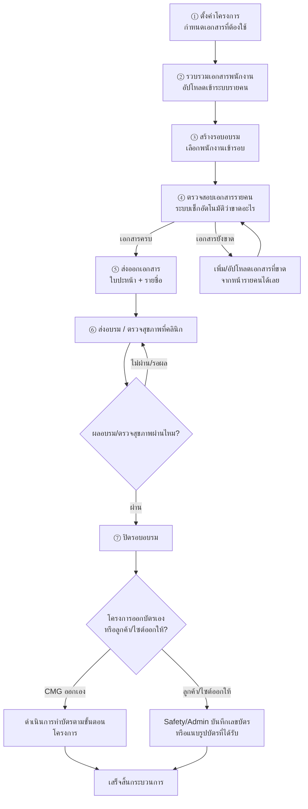
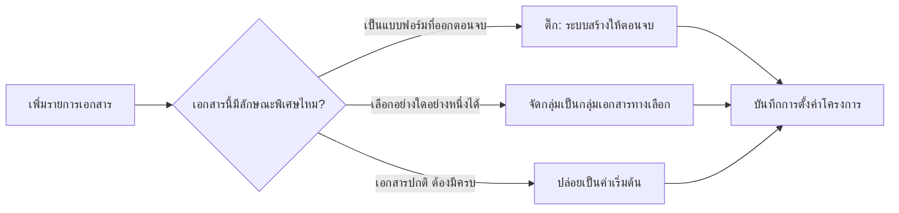
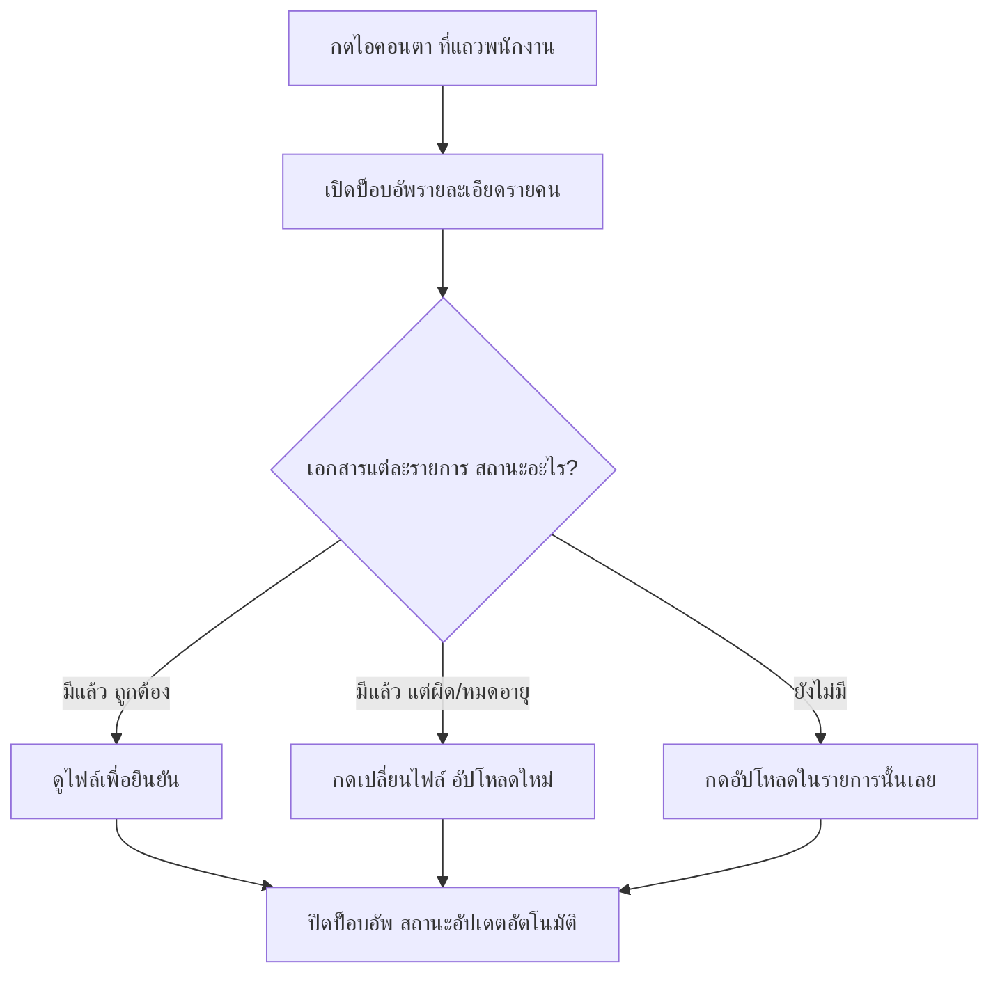
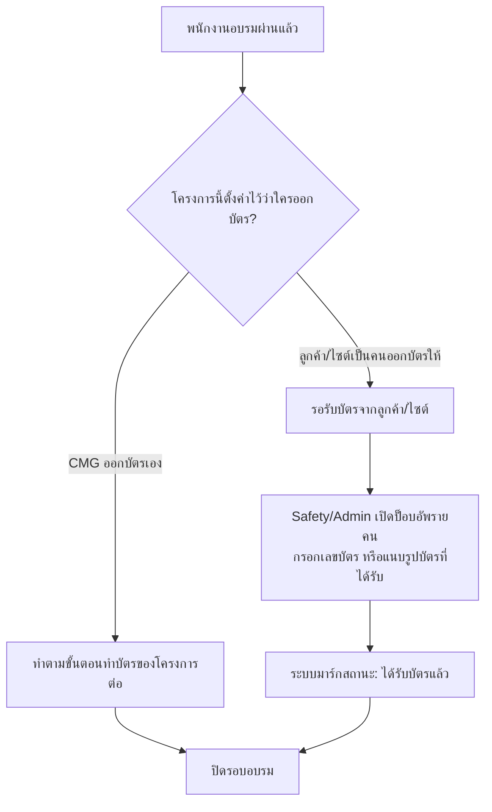

# คู่มือกระบวนการเอกสารฝึกอบรมพนักงาน (ฉบับทีมงาน)

เอกสารนี้สรุปขั้นตอนทั้งหมดของกระบวนการ "เตรียมเอกสาร → ส่งพนักงานเข้าอบรม → ปิดรอบ" ให้เข้าใจง่าย สำหรับทีม HR/Safety/Admin ที่ใช้งานระบบจริง ใช้สอนงานพนักงานใหม่ หรือทบทวนขั้นตอนได้

---

## 1) ภาพรวมกระบวนการทั้งหมด

**สรุปสั้น ๆ**: ทำครั้งเดียวตอนตั้งโครงการ (ขั้นตอน ①) จากนั้นขั้นตอน ②–⑦ จะวนทำทุกรอบที่มีพนักงานเข้าอบรม

---

## 2) ตั้งค่าโครงการ — กำหนดว่าเอกสารอะไรบ้างที่ต้องใช้

**ใช้เมื่อไร**: ทำครั้งแรกตอนเปิดโครงการใหม่ หรือเมื่อลูกค้าเปลี่ยนเงื่อนไขเอกสาร
**ใครทำ**: HR ที่ดูแลโครงการนั้น
**อยู่ที่หน้า**: ตั้งค่าเอกสารโครงการ (Project Document Requirements)

### ขั้นตอน
1. เลือกโครงการที่ต้องการตั้งค่า
2. เพิ่มรายการเอกสารที่โครงการนี้ต้องใช้ (เช่น รูปถ่าย, สำเนาบัตรประชาชน, ประกันต่าง ๆ)
3. ติ๊กเลือกคุณสมบัติพิเศษของแต่ละรายการ ถ้ามี:
   - **"ระบบ/HR สร้างให้ตอนจบ"** → ใช้กับเอกสารที่เป็นแบบฟอร์ม/เทมเพลตที่ออกตอนจบอบรม (เช่น ใบคำร้องขอบัตรผ่าน) **ไม่ต้องให้พนักงานอัปโหลด** ระบบจะไม่แจ้งว่า "ขาด"
   - **"กลุ่มเอกสารทางเลือก"** → ใช้กับเอกสารที่เลือกอย่างใดอย่างหนึ่งพอ เช่น กลุ่มประกัน (ประกันสังคม **หรือ** ประกันอุบัติเหตุ **หรือ** ประกันกลุ่ม) มีครบแค่ 1 ใน 3 ก็ถือว่าผ่าน
4. ตั้งค่า **"โครงการออกบัตรผ่านเอง หรือไม่"** (toggle) — ใช้กำหนดว่าหลังอบรมผ่านแล้ว ใครเป็นคนทำบัตรให้พนักงาน (ดูรายละเอียดขั้นตอน ⑦)

### จุดสำคัญที่ควรรู้
- ตั้งค่าแค่ครั้งเดียวต่อโครงการ ระบบจะใช้เงื่อนไขนี้ตรวจเอกสารของพนักงานทุกคน/ทุกรอบในโครงการนั้นอัตโนมัติ
- ถ้าลืมติ๊ก "กลุ่มเอกสารทางเลือก" ระบบจะมองว่าต้องมีครบทุกรายการ (เช่น ต้องมีประกันทั้ง 3 แบบ) ซึ่งจะทำให้ขึ้นแจ้งว่า "เอกสารขาด" ทั้งที่จริงมีครบแล้ว

---

## 3) รวบรวมเอกสารพนักงาน

**ใช้เมื่อไร**: ตั้งแต่รับพนักงานเข้าระบบ หรือเมื่อมีเอกสารใหม่ต้องเก็บเพิ่ม
**ใครทำ**: HR/Recruitment
**อยู่ที่หน้า**: ข้อมูลพนักงาน (Employee Documents) หรือหน้ารับเข้าใหม่ (Recruitment Intake)

- อัปโหลดเอกสารแต่ละประเภทแนบไว้ในโปรไฟล์พนักงานทีละคน
- เอกสารจะถูกเก็บไว้ที่จุดเดียว (ศูนย์กลางข้อมูลพนักงาน) และระบบอื่น ๆ เช่น หน้ารอบอบรม จะดึงไปใช้ตรวจสอบอัตโนมัติ ไม่ต้องอัปโหลดซ้ำ

> หมายเหตุ: สำเนาบัตรประชาชนตอนนี้แยกเป็น 2 แบบในระบบ — **"สำเนาบัตรประชาชน"** (ไฟล์ดิบ) กับ **"สำเนาบัตรประชาชน (เซ็นสำเนาถูกต้อง)"** — ให้เลือกประเภทให้ตรงกับไฟล์จริงที่ได้รับจากพนักงาน

---

## 4) สร้างรอบอบรม และเลือกพนักงานเข้ารอบ

**ใช้เมื่อไร**: เมื่อมีรอบอบรมใหม่สำหรับโครงการ
**ใครทำ**: HR/Training coordinator
**อยู่ที่หน้า**: รอบอบรม (Training Batch)

### ขั้นตอน
1. เลือกโครงการ และสร้างรอบอบรมใหม่
2. เลือกพนักงานที่จะเข้ารอบนี้ (เลือกจากรายชื่อที่มีในระบบเท่านั้น — ถ้าพนักงานยังไม่มีชื่อในระบบ ต้องไปเพิ่มข้อมูลพนักงานก่อน)
3. ระบบจะแสดงตารางรายชื่อ (roster) พร้อมสถานะเอกสารของแต่ละคนแบบ real-time

---

## 5) ตรวจสอบเอกสารรายคน — จุดที่ทำงานบ่อยที่สุด

**อยู่ที่หน้า**: รอบอบรม → กดไอคอนรูปตา 👁 ที่แถวของพนักงานคนนั้น → เปิดป็อบอัพ "รายละเอียดรายคน"

ในป็อบอัพจะเห็นครบในที่เดียว:

| ส่วน | ใช้ทำอะไร |
|---|---|
| รายการเอกสารที่โครงการนี้ต้องการ | เห็นครบทุกอย่าง ไม่ใช่แค่ที่ขาด |
| เอกสารที่มีแล้ว | กด "ดูไฟล์" เพื่อตรวจสอบว่าไฟล์ถูกต้องไหม |
| เอกสารที่ไม่ถูกต้อง/ต้องเปลี่ยน | กด "เปลี่ยนไฟล์" อัปโหลดใหม่ทับของเดิมได้ทันที |
| เอกสารที่ยังขาด | ระบบแสดงเป็นรายการ พร้อมปุ่มอัปโหลดในแต่ละรายการ |
| กลุ่มเอกสารทางเลือก (เช่น ประกัน) | แสดงเป็น 1 ชุด ไม่นับขาดถ้ามีครบ 1 ใน หลายตัวเลือกแล้ว |
| ผลตรวจสุขภาพ | ดู/บันทึกผลตรวจและวันหมดอายุ (6 เดือน) |
| บัตรผ่านที่ได้รับ (เฉพาะโครงการที่ลูกค้า/ไซต์ออกบัตรให้) | บันทึกเลขบัตร หรือแนบรูปบัตร |

> ไฟล์ที่อัปโหลด/เปลี่ยนจากหน้านี้ จะถูกบันทึกกลับไปที่โปรไฟล์พนักงานโดยอัตโนมัติ (จุดเดียวกับข้อ 3) ไม่ต้องไปอัปโหลดซ้ำที่หน้าข้อมูลพนักงานอีก

---

## 6) ตรวจสุขภาพที่คลินิก

**ใช้เมื่อไร**: ทุกโครงการต้องมีใบรับรองแพทย์ก่อนเข้าอบรม (อายุใบรับรอง 6 เดือน)
**ใครทำ**: HR สร้างลิงก์ส่งให้คลินิก / คลินิกเป็นคนกรอกผลกลับ

### ขั้นตอน
1. จากหน้ารอบอบรม กดสร้าง/คัดลอก "ลิงก์คลินิก" สำหรับรอบนั้น (ไม่ต้องให้คลินิกมีบัญชีผู้ใช้ในระบบ)
2. ส่งลิงก์ให้คลินิกทาง LINE/อีเมล
3. คลินิกกรอกผลตรวจและแนบใบรับรองแพทย์ผ่านลิงก์นั้นเอง
4. ระบบจะอัปเดตสถานะ "ผลตรวจสุขภาพ" และวันหมดอายุในหน้ารอบอบรมอัตโนมัติ (ขึ้นแจ้งเตือนเมื่อใกล้ครบ 6 เดือน)

---

## 7) ส่งออกเอกสาร — ใบปะหน้า + รายชื่อ

**ใช้เมื่อไร**: เมื่อเอกสารของทุกคนในรอบครบแล้ว พร้อมส่งเข้าอบรม
**อยู่ที่หน้า**: รอบอบรม → ปุ่ม Export

- **ใบปะหน้า (Training Request Form)**: ใช้แบบฟอร์ม PDF ของลูกค้า พิมพ์ชื่อบริษัท ("CMG Engineering & Construction" ทุกคน เพราะพนักงานทำงานผ่าน CMG) และรายชื่อพนักงานอัตโนมัติ
- **ใบรายชื่อ/รายคน**: ใช้รายชื่อที่มีอยู่ในระบบเท่านั้น ถ้าต้องแก้ไข/เพิ่มชื่อ ต้องย้อนกลับไปแก้ที่ข้อมูลพนักงานก่อน แล้วค่อยสร้างรอบ/export ใหม่

---

## 8) หลังอบรมผ่าน — ปิดรอบ และจัดการบัตรผ่านโครงการ

หลังพนักงานอบรมผ่านแล้ว แยกเป็น 2 กรณีตามการตั้งค่าโครงการ (ข้อ 2):

> **ข้อควรจำ**: "ใบคำร้องขอมีบัตรผ่านบุคคล" (เอกสารที่ระบบสร้างให้ตอนจบ ในข้อ 2) เป็นคนละเรื่องกับว่า "ใครเป็นคนออกบัตรจริง" — บางโครงการต้องยื่นใบคำร้องนี้ แต่บัตรจริงอาจออกโดยลูกค้า/ไซต์งาน ไม่ใช่ CMG ก็ได้

---

## สรุปใครทำอะไร

| บทบาท | หน้าที่หลัก |
|---|---|
| HR (ดูแลโครงการ) | ตั้งค่าเอกสารโครงการ, สร้างลิงก์คลินิก, export เอกสาร |
| HR/Recruitment | รวบรวม/อัปโหลดเอกสารพนักงานเข้าระบบ |
| Training coordinator | สร้างรอบอบรม, เลือกพนักงาน, ตรวจสอบเอกสารรายคนก่อนส่งอบรม |
| คลินิก | กรอกผลตรวจสุขภาพผ่านลิงก์ที่ได้รับ |
| Safety/Admin | บันทึกเลขบัตร/แนบรูปบัตรผ่านที่ได้รับจากลูกค้า (เฉพาะโครงการที่ลูกค้าออกบัตรให้) |

---

*เอกสารนี้อ้างอิงระบบ ณ วันที่ตั้งค่าโครงการ J-078 (HUASHI Building B) เป็นตัวอย่างอ้างอิง หากมีการเพิ่มฟีเจอร์ใหม่ในอนาคต ควรปรับปรุงคู่มือนี้ตามไปด้วย*
